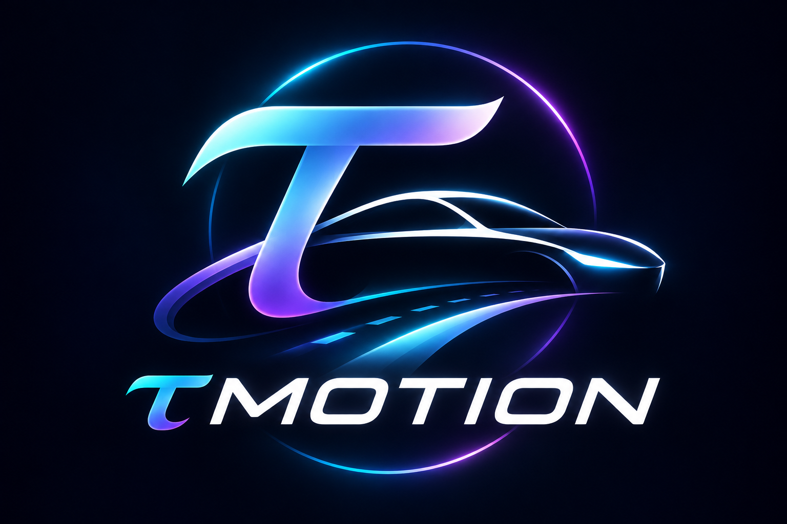
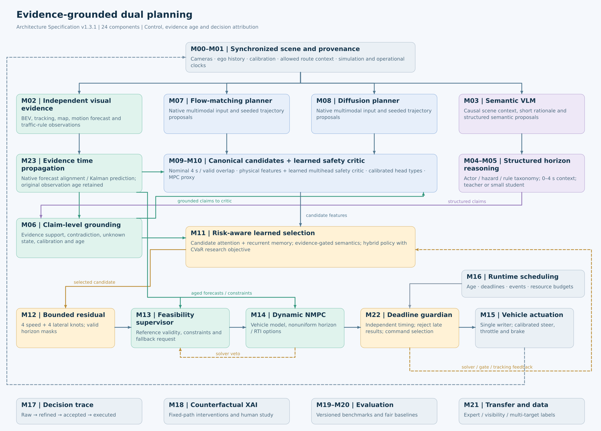

  

# τMOTION

*An Explainable, Risk-Aware Hybrid End-to-End Autonomous Driving Framework Integrating Vision-Language Reasoning, Reinforcement Learning, and Nonlinear Model Predictive Control.*

**Evidence-grounded dual planning with risk-aware selection, bounded refinement, and predictive control.**

**Architecture Specification v1.3.1 · Research design · Runtime validation pending**

[Architecture](#architecture) · [Component catalogue](docs/components.md) · [Research protocol](docs/experiments.md) · [PDF report](reports/TAUMOTION_Architecture_Specification_v1_3_1.pdf) · [Visual identity](docs/brand.md) · [Türkçe](README.tr.md)

τMOTION investigates how existing vision-language, perception, trajectory-generation, reinforcement-learning, and nonlinear predictive-control components can work together in closed-loop driving. The approach is reuse-first: retain strong pretrained engines, build explicit interfaces between them, and concentrate learning on a small selection/refinement policy and a horizon-reasoning student.

This repository contains the architecture, source selections, interface contracts, evaluation protocol, approved brand assets, and tools that build and check these artifacts. The vehicle runtime, native checkpoint inference, adapter parity, CARLA experiments, and hardware timing have **not yet been validated**. Documentation checks do not establish driving performance.

## Architecture

  

[Full-size SVG](assets/diagrams/v1_3_1/main_architecture.svg) · [Vector PDF](assets/diagrams/v1_3_1/main_architecture.pdf) · [Runtime diagram](assets/diagrams/v1_3_1/runtime_contract.svg) · [Learning and evidence diagram](assets/diagrams/v1_3_1/learning_and_evidence.svg)

The main flow is:

1. Synchronize camera history, ego state, calibration, allowed route context, and provenance.
2. Produce independent visual evidence; preserve its observation time when propagating tracks between expensive perception updates.
3. Generate semantic claims and horizon-specific reasoning, with support, contradiction, unknown, conflict, and stale states.
4. Obtain candidates from two pretrained trajectory generators and normalize their coordinates and common four-second comparison horizon.
5. Combine physical features with a small multihead learned safety/performance critic. Use a small recurrent, evidence-gated policy to select a candidate and propose bounded speed/lateral corrections.
6. Check reference feasibility, solve dynamic NMPC, and pass commands through an independent deadline guardian to one actuator writer.
7. Log the raw candidate, refinement, accepted reference, solver result, command-gate decision, and actual vehicle action.

The simplified dependency view below complements the full scientific diagram:

~~~mermaid
flowchart TD
    S["Synchronized scene / ego history"] --> E["Independent visual evidence"]
    S --> A["Flow-matching proposals"]
    S --> B["Diffusion proposals"]
    S --> V["Semantic VLM / structured CoT"]
    E --> T["Time-aligned evidence / uncertainty"]
    V --> G["Horizon reasoning / claim grounding"]
    T --> G
    A --> C["Canonical candidates / features"]
    B --> C
    T --> C
    G --> P["Risk-aware selection / bounded residual"]
    C --> K["Physical features + learned safety critic"]
    G --> K
    K --> P
    P --> F["Feasibility supervisor"]
    T --> F
    F --> N["Dynamic NMPC"]
    T --> N
    N --> D["Independent deadline guardian"]
    D --> U["Single vehicle command writer"]
    D -. "gate / timing feedback" .-> P
    N -. "tracking / solver feedback" .-> P
    U -. "next observation" .-> S
~~~

Generic scientific labels are used in the figures. Actual model, library, and code sources are disclosed below and in the source registry.

Read the [Turkish master](docs/FINAL_ARCHITECTURE_MASTER_TR.md), [English master](docs/FINAL_ARCHITECTURE_MASTER_EN.md), and [pre-publication review](docs/prepublication-review-v1.3.1.md). The figures above show the main flow; the [complete dependency graph](docs/dependency-graph.md) is generated from all 54 records (52 unique module pairs). The [eight earlier TR/EN diagrams](assets/diagrams/v1_2/) remain available as historical detailed views.

## Reuse map

| Function | Selected existing source | τMOTION integration work |
|---|---|---|
| Semantic VLM and flow planner A | [Qwen-Drive-1.0-4B](https://huggingface.co/Qwen/Qwen-Drive-1.0-4B), root VLM and reasoning-conditioned planner-rl | Native sensor/history adapter, seeded candidates, semantic schema, compatible weight-service reuse |
| Diffusion planner B | [ReCogDrive](https://github.com/xiaomi-research/recogdrive), VLM-2B + 2B-RL | Online feature/cache adapter, native preprocessing parity, candidate sampling |
| Independent evidence | [Bench2DriveZoo UniAD](https://github.com/Thinklab-SJTU/Bench2DriveZoo/tree/d9caa0af805ec3c435533aa268e2723d80c20017), 0.0.4-compatible branch | Export tracking/map/motion evidence before result pruning; validate domain and rig |
| Traffic-rule evidence | [Autoware traffic-light classifier](https://github.com/autowarefoundation/autoware_universe/tree/5f8fccaaf85d7aed68c723a7d6b566dff6d49c99/perception/autoware_traffic_light_classifier) | ROI, state, lane/stop-line association and uncertainty |
| Reasoning and evaluation building blocks | [AutoE2E](https://github.com/autowarefoundation/auto_e2e) | Reuse taxonomy, horizon head, coupling, teacher labels, faithfulness, rollout, profiling and AlpaSim plugin |
| Learned safety/performance scoring | [FPD-Drive](https://github.com/CountNemoChan/FPD-Drive) native scorer and ranking design | Train a small critic on canonical features; preserve per-head targets and calibrate. Native head weights are not transferable merely by matching dimensions. |
| Visibility, experts and multi-target data | [LEAD](https://github.com/kesai-labs/lead); FPD teacher methodology | Reuse expert/data/occlusion utilities, isolate privileged labels, build target masks and versioned caches. FPD teacher training code is not released in the inspected snapshot. |
| Strong native challengers | FPD-Drive, [BridgeDrive](https://github.com/ShuLiu-ETHZ/BridgeDrive), AutoE2E and classical Autoware | Separate native environments, sensors and control; no mandatory third online planner. |
| Small learning policy | [TorchRL](https://github.com/pytorch/rl) and [TensorDict](https://github.com/pytorch/tensordict) | Candidate-conditioned hybrid action, recurrent state, bounded residual and explicit CVaR extension |
| Predictive control | [acados](https://github.com/acados/acados) / CasADi | Vehicle identification, OCP constraints, reference adapter, timing and actuator conversion |
| Short-gap evidence propagation | [FilterPy 1.4.5](https://github.com/rlabbe/filterpy/tree/582885dd9e01c2784a5786b02fb527b46f090370) | Variable-dt prediction and calibrated uncertainty; preserve original capture time |
| Deadline command gate | CARLA command API; [Autoware gate](https://autowarefoundation.github.io/autoware_universe/main/control/autoware_vehicle_cmd_gate/) as a design reference/optional ROS backend | Small independent guardian for the native CARLA path; no claim that a complete Autoware stack is already integrated |

[Inspected source commits](specs/source_pins.json) · [Model selections](specs/model_selections.json) · [Research and limitations](docs/research.md)

Source commits are an inspection baseline. Runtime environments and downloaded checkpoint hashes remain to be locked and tested. Third-party code or weights are not vendored into this repository.

## Components and learning ownership

| Layer | Components | Responsibility |
|---|---|---|
| Inputs and evidence | M00–M02, M23 | Provenance, synchronization, independent perception and time propagation |
| Semantics | M03–M06 | VLM, taxonomy, horizon representation/student, grounding/calibration |
| Proposals | M07–M10 | Two native generators, trajectory normalization, candidate/control features plus learned safety critic |
| Learned decision | M11–M12 | Recurrent selection and bounded residual |
| Control | M13–M15, M22 | Feasibility, dynamic NMPC, command validity and actuation |
| Runtime and evaluation | M16–M21 | Scheduling, traces, XAI, benchmarks, baselines and data/transfer |

The large generators keep their pretrained weights in the main protocol. The small safety critic, policy, residual head, reasoning projections/student, and calibration parameters are the main learning targets. Native baseline training or domain-adaptation studies are separately labelled.

Every component has a necessity statement, reusable source, input/output, bridge, learning ownership, failure behavior, and acceptance evidence in the [24-component catalogue](docs/components.md).

## Final review and retained scope

Version **1.3.1** consolidates the supplied v1.3 package before its first repository publication. The 24 main modules, two frozen online generators and all research tracks are retained. This is a reviewed architecture specification, not a completed driving runtime.

- **Learning additions:** multihead safety critic, visibility/occlusion labels and future-privileged multi-target supervision remain in M10/M21; they are now reflected in the primary module fields and component catalogue.
- **Data boundary:** offline teacher/cache edges are explicitly OFFLINE_ONLY. Deployment transfers trained artifacts, never oracle labels into policy observations.
- **Asynchronous horizon:** delayed forecasts have a shorter valid remainder. A shared effective horizon and masks prevent padding from masquerading as new prediction.
- **Execution:** independent deadline guardian, single actuator writer, AoI-aware scheduling, warm-start/nonuniform NMPC pilots and staged PPO/CVaR remain central.
- **Attribution:** native sensor access, matched candidate counts, compute budgets and shared control are separate comparisons. Published LEAD scores are not relabelled as oracle-expert scores.
- **Publication:** the user-approved τ + vehicle PNG is byte-identical; current PDF, diagrams and validation tooling reflect this reviewed version.

[Full review](docs/prepublication-review-v1.3.1.md) · [Integration corrections](docs/integration-contract-v1.3.1.md) · [Source re-inspection](docs/source-audit-v1.3.1.md) · [Scope traceability](docs/scope-and-decisions.md)

RQ1–RQ9 plus RQ10/RQ11, E1–E24 plus E10-H, N0–N9 and C0–C10 remain in scope. Full AutoE2E, native classical Autoware, same-evidence rule+NMPC, privileged expert, FPD and BridgeDrive comparisons are distinct experiments. Visual-versus-language representations, iterative/data-diversity studies, human XAI, the small student, robustness and exploratory AlpaSim/NuRec transfer are retained.

## Runtime and hardware strategy

The hardware target is **2 × NVIDIA A5000**. Model residency, throughput, and closed-loop real-time feasibility have not been demonstrated on that target.

| Profile | Purpose |
|---|---|
| P0 | Synchronous research reference with teacher and both planners; report wall-clock cost |
| P1 | Asynchronous teacher and both planners, with explicit freshness and delay handling |
| P2 | Small external semantic student, retaining both planners and evidence |
| P3 | Conditional planner invocation, reporting candidate availability and age |

Perception, planners, and semantics may run at different rates; control and evidence propagation target 20 Hz. Candidate rates in the configuration are **pilot sweeps**, not achieved operating rates.

For NMPC, uniform/nonuniform grids, shorter horizons, warm starts, partial condensing, and supported AS-RTI variants are compared. Preparation and feedback costs are both reported. The guardian uses episode/generation/deadline checks; a fallback command is not a proof of collision-free stopping.

[Runtime contract](docs/runtime-contract.md) · [Pilot protocol](docs/pilot-protocol.md) · [Pilot configuration](specs/runtime_profiles.json)

## Research and evaluation

The research scope includes planner complementarity, learned selection, structured/horizon reasoning, grounding, risk/CVaR, residual refinement, NMPC feasibility, robustness, counterfactual and human XAI, model compression, scheduling, visual representations, iterative data collection, and exploratory transfer.

Benchmarks retain their own versions and metrics:

- NAVSIM v1.1 PDMS and v2.1.2 EPDMS in separate tables.
- KITScenes trajectory evaluation with natural and common horizons explicitly identified.
- CARLA 0.9.15 / Bench2Drive 0.0.4 closed-loop evaluation and separate Robust profiles.
- AutoE2E, SimLingo, classical agents, single-generator and dual-generator baselines.
- AlpaSim/NuRec as a distinct exploratory transfer track.

Comparisons use paired scenes/routes, separate training and traffic seeds, clustered uncertainty, tail sample counts, and compute measurements. Published results are not substituted for reproduced measurements. The benchmark future is available only in authorised training/evaluation paths, never as an inference feature.

[Complete experiment plan](docs/experiments.md) · [Methods](docs/methods.md) · [Comparison and evidence policy](docs/evidence-policy.md)

## Benchmark planning scenarios

The user-requested numerical scenarios are retained below. They are **subjective planning assumptions, not measured results, calibrated forecasts or confidence intervals**. No empirical τMOTION study supports these point values; they must not appear in a measured leaderboard.

| Protocol | Metric | Planning point | Illustrative band |
|---|---|---:|---:|
| NAVSIM v1.1 | PDMS ↑ | 92.5 | 91.5–93.5 |
| NAVSIM v2.1.2 navhard | EPDMS ↑ | 53 | 48–58 |
| Bench2Drive v0.0.4 | Driving Score ↑ | 82 | 75–85 |
| Bench2Drive v0.0.4 | Success Rate ↑ | 60% | 50–65% |
| KITScenes legacy 202 @3s | ADE ↓ | 0.60 m | 0.55–0.70 m |
| KITScenes legacy 202 @3s | FDE ↓ | 1.55 m | 1.35–1.85 m |

Legacy KITScenes and corrected canonical results are separate protocols. PDMS, EPDMS, Driving Score and Success Rate are different metrics. No common classical Autoware benchmark score is invented. [Assumptions, targets and upstream references](docs/benchmark-expectations-v1.3.md).

## Validation status

| Evidence | Status |
|---|---|
| Documentation and artifact integrity | Checked by repository tooling; see the report |
| Selected source/API inspection | Recorded with source links and commits |
| Native checkpoint inference | NOT RUN |
| Adapter output parity | NOT RUN |
| Runtime integration / deadline pilot | NOT RUN |
| CARLA closed-loop performance | NOT RUN |
| Hardware-specific real-time profile | NOT RUN |
| Critic calibration, teacher/visibility, strong challengers and counterfactual trials | NOT RUN |

[Documentation checks](reports/documentation_checks.json) · [Runtime evidence registry](specs/validation_registry.json)

A source or documentation check never automatically promotes a runtime validation level.

**GitHub CI:** the current credential cannot publish active workflows. The [workflow template](tools/ci/validate-docs.yml) is stored outside `.github/workflows/` and does not run automatically. Local and clean publication-copy validation passed; no GitHub Actions success is claimed.

## Rebuild the documentation

Python 3.10+, ReportLab, DejaVu fonts, and Poppler utilities are used for the vector/PDF/PNG artifacts. The standard-library validator does not require driving dependencies.

~~~bash
python3 -m pip install -r requirements-docs.txt
python3 tools/build_catalogue.py
python3 tools/build_diagrams_current.py
python3 tools/build_report_current.py
python3 tools/validate_spec.py
~~~

These commands build and check documentation. They do not download checkpoints, train a policy, or launch CARLA.

~~~text
assets/brand/       Approved PNG and clearly historical artwork
assets/diagrams/    Detailed scientific architecture and runtime diagrams
docs/              Detailed specification and research protocol (Turkish)
specs/             Machine-readable components, contracts, configurations and evidence
reports/           Consolidated PDF/HTML and documentation checks
tools/             Artifact builders and specification validation
~~~

## Approved visual identity and archive

The current logo is the user-approved **large Greek τ integrated with a vehicle silhouette**, violet/cyan illumination, and no roof LiDAR. The supplied PNG is preserved byte-for-byte; it is not presented as a vector reconstruction. Earlier SVG artwork remains historical.

[Approved original](assets/brand/TAUMOTION_APPROVED_FINAL_LOGO_2026-11-12.png) · [Brand rules and SHA-256](docs/brand-approved-v1.3.md) · [Decision history](history/README.md)

The original v1.0–v1.3 archive and raw conversations remain in the local delivery. Git includes the scientific specification, source records and decision summaries. [Publication boundary](docs/repository-publication.md) · [Archive hash inventory](specs/local_archive_inventory.json).

## Attribution and licensing

The integration contribution is explicitly separated from the pretrained models and reused libraries. Original source links and model identities remain visible even where diagrams use generic scientific labels. Referenced projects retain their own licenses; the repository contains no downloaded third-party weights. A project-wide redistribution license has not yet been assigned. See [NOTICE](NOTICE.md).
