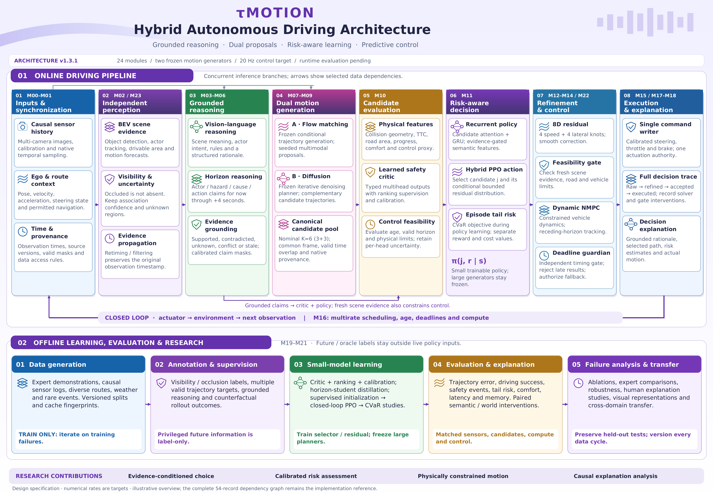

  

  

# τMOTION — Ayrıntılı bilimsel mimari

**Architecture Specification v1.3.1 · 24 modül · Kapsam korunmuştur · Çalışan sistem doğrulaması bekleniyor**

[Tam boy SVG](assets/diagrams/v1_3_1/architecture_poster.svg) · [4000 piksel PNG](assets/diagrams/v1_3_1/architecture_poster.png) · [Vektör PDF](assets/diagrams/v1_3_1/architecture_poster.pdf) · [English](README.md) · [Türkçe ana şartname](docs/FINAL_ARCHITECTURE_MASTER_TR.md) · [71 sayfalık rapor](reports/TAUMOTION_Architecture_Specification_v1_3_1.pdf)

τMOTION’un amacı, güçlü ve hazır algı, görsel-dil muhakemesi, hareket üretimi, öğrenme ve kontrol bileşenlerini bir yapboz gibi birleştirmektir. Her büyük modeli yeniden geliştirmek yerine, mevcut uygulamaların yerel çalışma biçimini koruyan adaptörler kurulur. Araştırmanın ağırlığı; bu parçaların hangi kanıtla, hangi zaman bilgisiyle ve hangi fiziksel kısıtlar altında birlikte karar vereceğindedir.

İki dondurulmuş hareket üreticisi aday yollar önerir. Bağımsız algı kolu, dilsel iddiaların ve hareket adaylarının geometrik dayanağını sağlar. Küçük bir güvenlik/performans eleştirmeni ile tekrarlayan politika adayları karşılaştırır; politika bir adayı seçerek sınırlı hız ve yanal konum düzeltmesi önerir. Fizibilite denetiminden geçen referans, dinamik doğrusal olmayan model öngörülü kontrolcüyle takip edilir. Bağımsız zaman sınırı gözeticisi komutu yetkilendirir ve tek bir eyleyici yazıcısı araca uygular.

Yeni görsel bu yapıyı üstte sekiz çevrimiçi işlev grubu, altta beş çevrimdışı öğrenme ve araştırma grubu olarak gösterir. Oklar seçilmiş veri bağımlılıklarıdır; bütün modellerin sırayla çalıştığı bir zaman çizelgesi değildir. Algı, semantik çıkarım ve hareket üretimi paralel kollardır. Onaylı logo değiştirilmeden görselin hemen üzerinde korunmuştur.

Bu anlatımda belirli kaynak uygulama adları yerine yöntemlerin bilimsel karşılıkları kullanılır. Kaynakların kimliği, incelenmiş sürümleri, yeniden kullanılan işlevleri ve lisansları [kaynak kayıtlarında](specs/source_pins.json), [model seçimlerinde](specs/model_selections.json), [bileşen kataloğunda](docs/components.md) ve [atıf belgesinde](NOTICE.md) açıkça bulunur.

## Sistemin mantığı ve modüllerin gerekliliği

| Katman | Modüller | İşlev ve gereklilik |
|---|---|---|
| Giriş sözleşmesi | M00–M01 | Kullanılabilir bilgiyi, zamanları, koordinatları ve kaynak kökenini tanımlar |
| Bağımsız kanıt | M02, M23 | Aktörleri, yol geometrisini, hareketi ve görünürlüğü kestirir; eski gözlemleri yaşını gizlemeden ilerletir |
| Anlamlandırma | M03–M06 | Sahne anlamını ve geleceğe ilişkin iddiaları yapılandırır, kanıta bağlar ve güvenilirliğine göre sınırlar |
| Hareket alternatifleri | M07–M09 | İki farklı üretim ailesini korur; çıktıları ortak ve geçerli bir zaman aralığında karşılaştırılabilir yapar |
| Aday değerlendirmesi | M10 | Fiziksel özellikleri küçük, çok başlıklı ve kalibre edilen bir güvenlik/performans modeliyle birleştirir |
| Öğrenilen karar | M11–M12 | Zamansal bağlamla aday seçer; küçük hız ve yanal konum düzeltmeleri üretir |
| Fiziksel uygulama | M13–M15, M22 | Referansı denetler, dinamik NMPC ile takip eder, geçersiz/gecikmiş komutu engeller ve tek yazıcıyla uygular |
| Çalışma ve araştırma | M16–M21 | Hesaplamayı zamanlar; iz, açıklama, karşılaştırma ve eğitim verisi döngüsünü yönetir |

[Bağımlılık grafiği](docs/dependency-graph.md) 54 veri aktarım kaydı ve 52 farklı yönlü modül çifti içerir. [Ayrıntılı mimari şeması](assets/diagrams/v1_3_1/main_architecture.svg), [zamanlama şeması](assets/diagrams/v1_3_1/runtime_contract.svg) ve [öğrenme şeması](assets/diagrams/v1_3_1/learning_and_evidence.svg), baştaki okunabilir genel görünümün tamamlayıcılarıdır.

## Girdi, bilgi yetkisi ve eşzamanlama — M00–M01

Girişler kamera geçmişi, kalibrasyon, aracın konum ve hareket durumu, direksiyon bilgisi, izin verilen rota bağlamı ve gözlem zamanlarından oluşur. M00, çalışma sırasında hangi bilginin kullanılabileceğini açıkça tanımlar. Gelecek görüntüler, simülatörün gerçek aktör durumları, ayrıcalıklı uzman çıktıları ve gerçekleşmemiş seçeneklere ait sonuçlar doğrudan çevrimiçi politika girdisi olamaz. Bunlar yetkili eğitim ve değerlendirme yollarında tutulur.

Bu ayrım, ayrıcalıklı bir nesneden birkaç alan silinerek değil, izin verilen alanlardan yeni bir gözlem oluşturularak uygulanır. Böylece sonradan eklenen bir alanın fark edilmeden sızması önlenir. Eğitim etiketinin geleceği görmesi ile öğrencinin çalışma sırasında geleceği görmesi farklı durumlardır.

M01 ortak sahne zarfını oluşturur; fakat her hazır modelin kamera düzenini, çözünürlüğünü ve zamansal örneklemesini korur. İki modelin aynı kavşakta bulunması, aynı bilgiyi aldığı anlamına gelmez. Konum, yönelim, hız, birim ve koordinat dönüşümleri beraber denetlenir. Simülasyon zamanı, gerçek işlem süresi ve karar zamanı birbirinin yerine kullanılmaz. Bu sözleşme, ters yanal eksen veya eski araç durumu gibi bütün sistemi bozabilecek entegrasyon hatalarını yakalamak için gereklidir.

## Bağımsız algı, görünürlük ve kanıtın yaşı — M02, M23

Bağımsız görsel algı hattı kuşbakışı sahne temsili, nesne tespiti, aktör takibi, sürülebilir alan, doluluk ve hareket öngörüsü üretir. Trafik ışığı rengi tek başına yeterli değildir: ışığın ilgili şerit ve dur çizgisiyle ilişkisi kurulmalı, belirsiz eşleşmeler açık bırakılmalıdır.

Bu kolun amacı, dilsel bir açıklamanın fiziksel dayanağını kontrol edebilmektir. Bağımsızlık ayrı bir model ve gözlem işleme yolu anlamındadır; hataların istatistiksel olarak bağımsız olduğu varsayılmaz. Kötü görüş, örtülme veya dağılım değişimi hem algıyı hem dil modelini yanıltabilir. Bir tespit güven skoru da doğrulanmadan olay olasılığına veya durum kovaryansına dönüştürülmez.

Görünürlük bilgisi kritik bir ayrımdır. Bir nesnenin tespit edilmemesi, orada bulunmadığını kanıtlamaz. Aktör örtülmüş, görüş alanı dışında veya ilişkilendirme için fazla belirsiz olabilir. M23, pahalı algı güncellemeleri arasında yerel hareket öngörüsü ya da kısa aralıklı kinematik filtreleme kullanarak durumu ilerletir. Orijinal gözlem zamanı, belirsizlik, tahmin bayrağı ve kalan geçerlilik ufku korunur.

Filtre yeni ortaya çıkan bir yayayı keşfedemez; gözlenmemiş trafik ışığının rengini yenileyemez. Süresi dolan kanıtın sessizce silinmesi yerine eski veya bilinmeyen olarak temsil edilmesi gerekir. Aksi halde daha az bilgiye sahip bir sistem, yolu yanlış biçimde daha boş ve güvenli görebilir.

## Yapılandırılmış semantik ve kanıta dayalı muhakeme — M03–M06

Görsel-dil modeli sahnenin anlamını, kuralları, aktör niyetlerini ve olası tehlikeleri yorumlar. Karardan önce kısa bir gerekçe ve denetlenebilir iddialar üretir. M04 bu içeriği aktör, ilişki, tehlike, neden, eylem, kural ve zaman ufku alanlarına dönüştürür. Bir aktör referansı sahnedeki bir nesneyle ilişkilendirilemiyorsa bilinmeyen olarak kalır.

M05 mevcut durum ile yaklaşık +1, +2, +3 ve +4 saniyelik değerlendirmeleri ayırır. Şu anda görülen bir konum ile gelecekte olabilecek bir geçiş aynı kanıt statüsünde değildir. Yapılandırma, bütün bir paragrafı doğru kabul etmek yerine her iddiayı ayrı sınamayı ve kontrollü açıklama deneyleri yapmayı mümkün kılar.

Küçük ufuk öğrencisi, çevrimdışı öğretmen etiketlerinden öğrenerek izin verilen algı özellikleri, araç geçmişi ve rota bağlamıyla zamansal muhakeme üretir. Hesaplama tasarrufu bütün bağımlılık zincirinde ölçülür. Küçük bir başlık çalışma sırasında hâlâ büyük dil omurgasına ihtiyaç duyuyorsa, büyük modelin maliyetinin ortadan kalktığı söylenemez.

M06 iddiaları aktör eşleşmesi, görünürlük, geometri, hareket öngörüsü ve bilgi yaşıyla denetler. Çıktı durumları desteklenen, çürütülen, bilinmeyen, çelişkili ve eskimiş olarak ayrılır. Geleceğe ilişkin bir iddia mevcut öngörülerle tutarlı bulunabilir; gelecekte kesinlikle gerçekleşeceği onaylanmış olmaz.

Semantik özellikler küçük politikaya kanıt duyarlı bir kapı üzerinden katılır. Örnek gösterim `z = z_base + α · g(kanıt, yaş) · P(z_reason)` biçimindedir. Kapı, eski veya dayanıksız bilginin etkisini azaltır. Başlangıçta küçük bağlaşım, temel davranışı koruyabilir; normal başlatılan projeksiyon öğrenme yolunu açık tutar. Bu dış birleştirme, dondurulmuş üreticilerin iç katmanlarına sınırsız dil komutu eklemek değildir.

## İki dondurulmuş hareket üreticisi — M07–M09

Birinci üretici koşullu akış eşleme ile öğrenilmiş sürekli bir dönüşüm sürecinden yörünge üretir. İkinci üretici kendi görsel ve araç koşullandırması altında yinelemeli difüzyonla gürültü gidererek yörünge oluşturur. Ana protokolde iki büyük üreticinin de önceden eğitilmiş ağırlıkları sabit kalır.

Farklı üretim ailelerinin amacı, sahnede farklı geçerli hareket seçenekleri sağlamaktır. Ancak farklı mimariler tamamlayıcılığı garanti etmez; ikisi de aynı hatalı varsayıma dayanabilir. Başlangıç aday havuzu her üreticiden üç olmak üzere K=6’dır. K=2/6/12 ve eşit hesaplama deneyleri, çeşitlilik yararını daha fazla örnekleme maliyetinden ayırır.

M09 yerel örnekleri, tohumları, kaynak zamanlarını ve üretici kimliğini saklayarak adayları ortak koordinata dönüştürür. Seçilmiş yerel ayarlar yaklaşık beş saniye/0,1 saniye ve dört saniye/0,5 saniye biçimindedir. Nominal karşılaştırma dört saniyelik, 0,1 saniye aralıklı bir ızgaradadır. İnterpolasyon, seyrek çıktıya yeni öngörü bilgisi kazandırmaz.

Asenkron çalışmada kalan ufuk ayrıca hesaplanır: `kaynak zamanı + yerel ufuk − karar zamanı`. Dört saniyelik öngörü 0,3 saniye geç geldiğinde geleceğe ait geçerli kısmı 3,7 saniyedir. Adaylar ortak geçerli kesişimde karşılaştırılır; doldurulmuş noktalar maskelenir. Düzeltme ve kontrol de aynı kalan geçerliliğe uyar. Böylece gecikmiş bir tahminin sonuna yapay nokta ekleyip yeniden dört saniyelik bilgi varmış gibi davranılmaz.

## Fiziksel özellikler ve öğrenilen güvenlik eleştirmeni — M10

Her aday için çarpışma geometrisi, çarpışmaya kalan süre, yol alanı uyumu, ilerleme, hız, ivme, sarsım, eğrilik, üreticiler arası anlaşmazlık, bilgi yaşı ve kontrol edilebilirlik göstergeleri çıkarılır. Öğrenilen model eklendiğinde bu açık fiziksel özellikler kaldırılmaz.

Küçük çok başlıklı eleştirmen; güvenlik, kurallara uyum, ilerleme, konfor ve takip fizibilitesini değerlendirir. Başlıklara göre sınıflandırma, regresyon veya sıralama hedefi kullanılır. Her başlığın etiket tanımı, çıktı türü, ufku, geçerlilik maskesi ve kalibrasyon durumu bulunur. Sigmoid çıktısı kendiliğinden kalibre edilmiş bir olay olasılığı değildir. Kusurlu olunmayan çarpışma ölçütü ile herhangi bir fiziksel çarpışmadan kaçınma olasılığı da aynı değildir.

Denetimli öğrenme, aday sıralama ve kalibrasyon birlikte değerlendirilir. Özellikle tehlikeli bir adayın yüksek ilerleme puanı nedeniyle güvenli görünmesi incelenir. Yanlış güvenli seçim oranı, sıralama kaybı ve farklı görünürlük gruplarındaki kalibrasyon raporlanır.

Hazır puanlama yapısı tekrar kullanılabilir; ancak eğitilmiş başlık ağırlıkları kendi özgün özellik uzayına bağlıdır. Tensör boyutlarının eşleşmesi ağırlık uyumluluğu sağlamaz. Bu nedenle ortak aday özellikleri üzerinde küçük eleştirmenin ayrıca eğitilmesi açık bir entegrasyon işidir. Bu model, politika ödül-değer ağı veya bölüm kuyruk maliyeti değer ağıyla karıştırılmaz ve fiziksel fizibilite denetimini geçersiz kılamaz.

## Tekrarlayan seçim politikası ve bölüm düzeyinde CVaR — M11

Ortak aday kodlayıcı ve dikkat mekanizması seçenekleri karşılaştırır. Kapılı tekrarlayan birim, yakın geçmişteki kanıt ve kontrol sonuçlarını taşır. Böylece her karar yalnızca tek kareden verilmez. Aday sırasını değiştirerek yapılan kontroller, dizi konumunun yapay avantaj oluşturup oluşturmadığını gösterir. Tekrarlayan durum bölüm sınırında sıfırlanır ve eğitim dizilerinde tutarlı biçimde yönetilir.

Eylem iki parçalıdır: kategorik aday seçimi ve seçilen adaya koşullu sürekli düzeltme. Dağılım `π(j,u|s) = π(j|s) · π(u|s,j)` biçiminde tanımlanır. Geçersiz adaylar maskelenir; kullanılabilir aday yoksa açık bir durma veya geri dönüş davranışı devreye girer. Yakın politika optimizasyonu, ayrık ve sürekli parçaların olasılık terimlerini ve düzeltmeyi sınırlayan dönüşümü birlikte hesaba katar.

Fiziksel denetleyici öneriyi değiştirirse politikanın örneklediği eylem ile gerçekten uygulanan eylem ayrı kaydedilir. Eğitimde, gözeticinin yerine koyduğu komutun olasılığı politikanın kendi örneklediği eylemin olasılığı gibi kullanılmaz. Müdahale sıklığı da değerlendirme sonucudur.

Ödül, ilerleme, tamamlama ve konforu destekler. Ayrı bölüm maliyeti ihlalleri, yakın tehlike şiddetini ve kontrol başarısızlıklarını temsil eder. Tek bir toplam puanın kötüleşen güvenlik boyutlarını gizlememesi için olay ölçümleri ayrıca raporlanır.

Koşullu riske maruz değer, bölüm maliyetinin üst kuyruğuna odaklanır: `CVaRα(C) = minη [η + E(max(C−η,0))/(1−α)]`. Tasarım, kuyruk maliyeti bütçesi altında ödül iyileştirmesini inceler; α=0,90 ve α=0,95 duyarlılık deneyleri içerir. Burada CVaR, mevcut altı adayın puanlarına uygulanan anlık bir özet değildir. Tam sürüş bölümlerinden elde edilen maliyetler üzerinden eğitim hedefidir.

Yeterli tam bölüm, tutarlı davranış politikası sürümleri, etkili kuyruk örnek sayısı ve kararlı kantil tahmini gerekir. Eski politika verileri sessizce güncel politika verisi sayılmaz. Zorlaştırılmış eğitim dağılımı ile doğal test dağılımının kuyruk riski ayrı raporlanır. Yöntem yakınsama garantisi veya sıfır çarpışma sertifikası sağlamaz.

## Sınırlı düzeltme, fizibilite ve dinamik NMPC — M12–M15, M22

M12 sekiz sürekli boyut kullanır: dört hız farkı ve dört yanal konum farkı düğümü. Yumuşak interpolasyon düzeltmeyi geçerli ufka dağıtır. Başlangıç sınırları yaklaşık ±2 m/s ve ±0,5 m’dir; araç ve koşullarla doğrulanmalıdır. Başlangıç durumunun sürekliliği, negatif olmayan hız, yönelim güncellemesi ve düzeltme sonrası eğrilik/risk denetimi korunur.

Bu mekanizma iki büyük üreticiyi yeniden eğitmeden yerel iyileştirme sağlar. Ancak bütün adaylarda eksik olan büyük bir manevrayı küçük düzeltmenin yaratacağı varsayılmaz. M13 güncel sahne kanıtı, araç sınırları, yol geometrisi ve kalan ufukla referansı denetler. Önceki referans yalnızca kalan kısmı güncel denetimden geçiyorsa sürdürülebilir.

M14’ün ana yöntemi dinamik doğrusal olmayan model öngörülü kontroldür. Nominal durum `[X,Y,ψ,vx,vy,r,δ,a]`, kontrol girdileri direksiyon açısal hızı ve sarsımdır. Takip hatası, kontrol yumuşaklığı ve gevşeklik cezaları; eyleyici, yol ve engel kısıtları altında dengelenir. Kütle, atalet, aks geometrisi ve lastik davranışı tanımlanmalıdır. Düşük hızda dinamik modelin düzenlenmesi veya başka bir formülle harmanlanması gerekebilir.

Başlangıç ufku dört saniye ve kırk adet 0,1 saniyelik optimizasyon aralığıdır. Kontrol hedefi 20 Hz’dir. Daha kısa ya da eşit aralıklı olmayan ızgaralar, önceki çözümle başlatma, kısmi yoğunlaştırma ve gerçek zaman yineleme seçenekleri pilotta karşılaştırılır. Normal akışta düşük maliyetli fizibilite vekili bütün adayları inceler; tam optimizasyon seçilmiş referansı takip eder. İlk birkaç aday için tam çözüm deneyleri ek maliyetin yararını ölçer.

M22 çözücüden ayrı çalışan zaman ve geçerlilik gözeticisidir. Bölüm, üretim, sahne anlık görüntüsü, son teslim zamanı ve komut yaşını denetler. Çözücünün takılmasını beklemez; geç gelen eski sonuç yeni kontrol adımını geçersiz kılamaz. Geçerli çözümü, hâlâ geçerli devam komutunu veya kalibre edilmiş geri dönüş profilini yetkilendirir. Fren komutu verilmesi, görünmeyen engel veya değişen sürtünmede çarpışmasız duruş kanıtı değildir.

M15 tek eyleyici yazıcısıdır. Yetkilendirilen fiziksel komutu kalibre edilmiş direksiyon, gaz ve fren değerlerine dönüştürür. Normal ve geri dönüş komutları aynı yetkiden geçer. Doyumlar, gaz-fren çakışmaları ve gerçekten uygulanan komut kaydedilir.

## Çok frekanslı zamanlama ve iki hızlandırıcının maliyeti — M16

Hedef donanım iki adet 24 GB hızlandırıcıdır. Model ağırlıkları, aktivasyonlar, süreç bağlamları, simülasyon görüntüleme, ön işleme ve cihazlar arası aktarım beraber profillenmelidir. İki cihazın belleği tek bir 48 GB alan gibi varsayılmaz.

| Profil | İçerik | Ölçülen amaç |
|---|---|---|
| P0 | Eşzamanlı öğretmen, bağımsız algı ve iki üretici | Gerçek işlem maliyeti saklanmadan davranış referansı |
| P1 | Asenkron öğretmen ve iki üretici | Bilgi yaşını koruyarak gecikme ve işlem örtüşmesi |
| P2 | Küçük harici semantik öğrenci, algı ve iki üretici | Muhakeme aktarımının gerçek bağımlılık maliyetini azaltması |
| P3 | Koşullu üretici çağrısı | Aday eksikliği ve eskiliği görünürken hesaplama tasarrufu |

Pilot ayarlar hareket üretimi için 1/2/5 Hz, algı için 2,5/5/10 Hz, semantik için 0,5/1/2 Hz içerir. Kontrol ve kanıt ilerletme 20 Hz hedefler. Bunlar elde edilmiş hızlar değildir. Güncelleme sıklığını azaltmak, modelin beklediği geçmiş kareleri eksiltme yetkisi vermez.

Pahalı çalışan başına devam eden işin yanında en fazla bir bekleyen istek tutulur; yeni bekleyen istek daha eskisinin yerini alır. Mantıksal iptal, çalışmakta olan hızlandırıcı çekirdeğini mutlaka durdurmaz. Bilginin yaşı, sonuç üretiminin bittiği zamandan değil onu besleyen gözlemden hesaplanır.

20 Hz için 50 ms bütçe yalnızca çözücüye ait değildir. Sahne okuma, referans denetimi, çözücü geri beslemesi, komut kapısı, yayın ve zamanlama sapması beraber bu bütçeye sığmalıdır. Hazırlık işlemi başka zamanda çalıştırılsa bile toplam maliyete yazılır. İzin verilen bilgi yaşı sınırları pilot ölçümüne kadar belirlenmiş sayılmaz. [Zamanlama sözleşmesi](docs/runtime-contract.md) · [Pilot protokolü](docs/pilot-protocol.md) · [Ayarlar](specs/runtime_profiles.json).

## Çevrimdışı veri ve aşamalı öğrenme — M21

Uzman gösterimleri, kayıtlı sahneler ve simülasyon bölümleri; rota, hava, senaryo, sensör ve tohum bilgileriyle sürümlenir. Etiket üretimi geleceği veya dünya durumunu kullanabilir; öğrenenin girişleri nedensel kalır. Önbellek parmak izi ön işleme, kaynak model, veri ayrımı ve etiket sürümünü içerir.

Görünürlük etiketleri uzman ile öğrenen arasındaki bilgi farkını açığa çıkarır. Uzman, öğrencinin göremediği aktöre tepki vermiş olabilir. Çevrimdışı örnek, derinlik ve aktör durumu bilgileri bu durumu etiketler; ek çalışma sensörü haline gelmez. Çok hedefli gözetim, tek bir gösterimin tek kabul edilebilir hareket olmadığı fikrine dayanır. Birden fazla geçerli yörünge sıralama ve eleştirmen eğitimini destekler.

Kayıtlı gelecek yalnızca gerçekleşmiş eylemin geleceğidir. Uygulanmamış bütün alternatiflerin sonucunu kanıtlamaz. Karşıolgusal etiket için uygun yeniden yürütme veya açıkça tanımlanmış bir yaklaşım gerekir; yetersiz kanıt maskelenir.

Çalışma sırası yerel çıktı ve adaptör eşdeğerliği, aday önbelleği, eleştirmen/öğrenci eğitimi, denetimli sıralama başlangıcı, küçük kapalı çevrim PPO pilotu, sınırlı düzeltme ve ardından CVaR çalışmalarından oluşur. Büyük modelleri dondurmak gradyan maliyetini kaldırır; bölüm toplarken çıkarım maliyetini kaldırmaz. İteratif veri toplama eğitim başarısızlıklarından beslenir; ayrılmış test kümesi veri iyileştirme döngüsüne girmez.

## Karar izleri, açıklanabilirlik ve karşılaştırmalar — M17–M20

M17; gözlemi, adayları, eleştirmen çıktılarını, politika durumunu, örneklenmiş eylemi, düzeltmeyi, kabul edilmiş referansı, çözücü tanılarını, gözetici kararını ve gerçek hareketi birbirine bağlar. Böylece görülen başarının politika kararı mı, fiziksel müdahale mi, yoksa zaman aşımı geri dönüşü mü olduğu anlaşılır.

M18 açıklamanın kanıta dayanmasını, kararı etkileyip etkilemediğini ve bu etkinin uygunluğunu araştırır. Semantik müdahalede aday/kanıt anlık görüntüsü, tekrarlayan durum, rastgelelik ve çözücü başlangıcı sabit tutulup bir iddia veya ufuk özelliği değiştirilir. Dünya müdahalesinde fiziksel aktör ya da sinyal değiştirilir. İkinci durumda duyusal giriş de değiştiğinden sonuç tek başına semantik kanalın etkisini izole etmez.

İnsan çalışmaları anlaşılabilirliği, güvenin doğrulukla uyumunu ve doğru/yanlış kararın ayırt edilmesini ölçer. Akıcı fakat yanıltıcı açıklamanın insanda daha fazla güven yaratması başarı kabul edilmez.

M19 yörünge hatası, rota tamamlama, sürüş başarısı, çarpışma, ihlal, yakın tehlike, konfor, fizibilite, bölüm kuyruk riski, gecikme ve belleği ayrı protokollerle raporlar. Güvenli bir alternatif insan referansından farklı olabilir; taklit hatası güvenlikle aynı ölçüt değildir. Eşleştirilmiş rotalar, birden fazla eğitim/trafik tohumu, senaryo kümelerini dikkate alan belirsizlik ve başarısız denemeler sonuçlara dahildir.

M20 güçlü yerel öğrenilmiş sistemleri, tam klasik yığını, ayrıcalıklı uzmanı, aynı kanıtla çalışan kural tabanlı planlayıcı ve ortak kontrolcüyü, hafif zamansal görsel planlayıcıyı korur. Tek üretici, sabit aday havuzu, sezgisel/denetimli sıralama, eleştirmen başlıkları, tekrarlama, düzeltme ve risk hedefi ablasyonları ayrı sorulara cevap verir.

Model mimarisinin etkisi, sensör erişimi ve hesaplama bütçesinden ayrıştırılır. Aynı aday sayısı aynı hesaplama değildir. Tam yerel sistem karşılaştırması, sabit adaylardan seçim çalışmasıyla eşdeğer değildir. Önceden eğitilmiş bir modelde sonradan sensör maskelemek de eşit eğitim bilgisi sağlamaz. En iyi adayın ayrıcalıklı seçimi yalnızca çevrimdışı fırsat sınırıdır; çalışırken politikaya verilemez.

## Bir kavşakta bütün akış nasıl işler?

Kavşakta çapraz trafik görünürken bir yaya kısmen örtülmüş olsun. Eşzamanlama, her kolun hangi görüntü ve araç durumunu gördüğünü belirler. Algı aktör izlerini ve görünürlük belirsizliğini üretir; ilerletme son gerçek gözlemin yaşını korur. Semantik kol yol verme gerekçesi ve zamansal tehlike iddiaları üretir; dayanak denetimi bunları destekler veya belirsiz bırakır.

İki üretici aynı sırada farklı ilerleme ve frenleme profilleri önerir. Adaylar ortak geçerli ufukta karşılaştırılır. Fiziksel özellikler ve öğrenilmiş puanlar risk, konfor, ilerleme ve takip zorluklarını ortaya koyar. Tekrarlayan politika bir adayı ve küçük düzeltmeyi seçer. Fizibilite gözetimi referansı denetler; NMPC komutu hesaplar; bağımsız gözetici sonucun hâlâ zamanında ve geçerli olduğunu kontrol eder.

Tek yazıcı yetkilendirilen komutu uygular, yeni gözlem çevrimi kapatır. Sonraki inceleme yaya iddiasının seçimi değiştirip değiştirmediğini, eleştirmenin sıralamasını, gözetici müdahalesini ve insanın gerçekten uygulanan hareketin açıklamasını anlayıp anlamadığını ayrı ayrı araştırır.

## Hazır parçalar arasındaki köprüler

| Hazır yöntem ailesi | Korunan işlev | τMOTION’un kurduğu köprü |
|---|---|---|
| Görsel-dil çıkarımı | Yerel görüntü kodlama ve semantik üretim | Nedensel giriş, iddia şeması, aktör eşleşmesi ve ufuk temsili |
| Görsel sahne kestirimi | Tespit, takip, yol/doluluk ve hareket çıktısı | Kanıt dışa aktarımı, görünürlük, kural ilişkisi ve zaman yönetimi |
| Akış eşleme ve difüzyon | Dondurulmuş yerel yörünge üretimi | Sensör/geçmiş adaptörü, tohumlar, çıktı eşdeğerliği ve ortak geçerlilik |
| Çok başlıklı puanlama | Puanlama yapısı ve etiketleme araçları | Ortak özellik uzayı, hedef türleri, küçük model eğitimi ve kalibrasyon |
| Tekrarlayan aktör-eleştirmen | Dizi işleme ve politika optimizasyonu | Hibrit eylem, aday maskesi, düzeltme sınırları ve bölüm kuyruk riski |
| Doğrusal olmayan kontrol | Dinamik ayrıklaştırma ve optimizasyon | Araç tanılama, referans, zaman bütçesi ve eyleyici kalibrasyonu |
| Durum filtreleme | Değişken zamanlı tahmin ve belirsizlik | Gerçek gözlem yaşı, ilişkilendirme ve geçerlilik sonu |
| Uzman/veri/yeniden yürütme | Gösterim, etiket ve kontrollü deney | Ayrıcalık sınırı, çok hedef, önbellek ve adil karşılaştırma |
| Komut yetkilendirme | Geçerlilik ve geri dönüş davranışı | Bağımsız süreç, üretim/son tarih kontrolü ve tek yazıcı |

Yeniden kullanım entegrasyon gereğini ortadan kaldırmaz. Yerel uygulama önce kendi koşullarında çalıştırılır; sonra adaptörlü çıktıyla karşılaştırılır. Bir model çağrısının başarılı olması, koordinatın doğru olduğunu veya kullanılan ağırlığın yeni özellik uzayıyla uyumlu olduğunu göstermez. Araştırmanın mühendislik katkısı bu sözleşmelerin açık, izlenebilir ve sınanabilir kurulmasıdır.

Her modülün gerekliliği, kaynağı, giriş/çıkışı, yeniden kullanılan kısmı, köprüsü, öğrenme sorumluluğu, başarısızlık davranışı ve kabul kanıtı [24 bileşenlik katalogda](docs/components.md) tanımlıdır. [Entegrasyon düzeltmeleri](docs/integration-contract-v1.3.1.md) ve [kaynak incelemesi](docs/source-audit-v1.3.1.md) uygulamaya özgü ayrıntıları saklar.

## Korunan araştırma kapsamı ve doğrulama durumu

RQ1–RQ11, E1–E24 ve E10-H ile N0–N9/C0–C10 karşılaştırma aileleri korunur. Üretici tamamlayıcılığı, görsel/dilsel temsil, kanıt dayanağı, ufuk öğrencisi, eleştirmen, görünürlük, çok hedefli gözetim, tekrarlayan seçim, düzeltme, CVaR, NMPC, zamanlama, dayanıklılık, sıkıştırma, insan açıklama çalışmaları, veri çeşitliliği, iteratif toplama ve keşif amaçlı ortam aktarımı kapsam içindedir. Ana çalışma hattına üçüncü çevrimiçi üretici zorunluluğu eklenmemiştir.

Önceki altı sayısal planlama senaryosu [varsayım belgesinde](docs/benchmark-expectations-v1.3.md) korunur. Bunlar ölçülmüş başarı, kalibre edilmiş tahmin veya güven aralığı değildir. Bu sunum güncellemesi araştırmayı daraltmaz ve mimari sürümünü değiştirmez.

| Kanıt türü | Durum |
|---|---|
| Doküman, yapılandırılmış sözleşme, yerel bağlantı ve görsel bütünlüğü | Depo doğrulayıcısıyla kontrol ediliyor |
| Kaynak/API incelemesi | Sürüm ve bağlantılarıyla kayıtlı |
| Yerel model çıkarımı ve adaptör eşdeğerliği | NOT RUN |
| Eleştirmen, öğrenci, politika, düzeltme ve CVaR eğitimi | NOT RUN |
| Kontrolcü, gözetici, zamanlama ve hedef donanım ölçümleri | NOT RUN |
| Kapalı çevrim sürüş, dayanıklılık, aktarım ve açıklama deneyleri | NOT RUN |

[Dokümantasyon kontrol raporu](reports/documentation_checks.json) · [Çalışma kanıtı sicili](specs/validation_registry.json) · [Deney matrisi](docs/experiments.md) · [Yöntem sözleşmeleri](docs/methods.md) · [Kapsam izlenebilirliği](docs/scope-and-decisions.md).

“Hibrit uçtan uca” ifadesi, önceden öğrenilmiş hareket üretiminin bütün sürüş sistemi içine alınmasını anlatır. Bütün yığın tek bir türevlenebilir ağ olarak birlikte eğitilmez. Nihai olan mimari şartnamesidir; çalışan sistemin başarısı için uygulama ve deney kanıtı gerekir. Dokümantasyon kontrollerinin geçmesi bu kanıtın yerine geçmez. Depodaki [CI şablonu](tools/ci/validate-docs.yml) etkin değildir; otomatik çalışmış bir kontrol olarak sunulmaz.

## Görseli ve belgeleri yeniden üretme

Python 3.10+, ReportLab, DejaVu yazı tipleri ve Poppler kullanılır. Yeni poster düzenlenebilir vektör şekil ve metinlerden oluşur; README için yüksek çözünürlüklü PNG, paylaşım için SVG ve PDF üretilir.

~~~bash
python3 -m pip install -r requirements-docs.txt
python3 tools/build_architecture_poster.py
python3 tools/build_catalogue.py
python3 tools/build_diagrams_current.py
python3 tools/build_report_current.py
python3 tools/validate_spec.py
~~~

Bu komutlar belge üretir; model indirmez, politika eğitmez veya araç sürüşü başlatmaz. [Görsel tasarım notları](docs/architecture-poster.md) · [İngilizce bilimsel anlatım](docs/scientific-walkthrough.md).

Onaylı büyük τ ve araç silüetli logo özgün dosyasıyla korunur. [Logo ve dosya özeti](docs/brand-approved-v1.3.md). Ham sohbetler ve özgün teslim arşivi yerel klasörde kalır; Git deposu bilimsel şartname, kaynak kayıtları ve karar özetlerini içerir. [Yayın sınırı](docs/repository-publication.md) · [Karar geçmişi](history/README.md). Üçüncü taraf ağırlıkları bu depoda dağıtılmaz; kaynakların lisansları kendi koşullarıyla geçerlidir. Depo geneline ait yeniden dağıtım lisansı henüz atanmamıştır; [atıf ve lisans notuna](NOTICE.md) bakınız.
