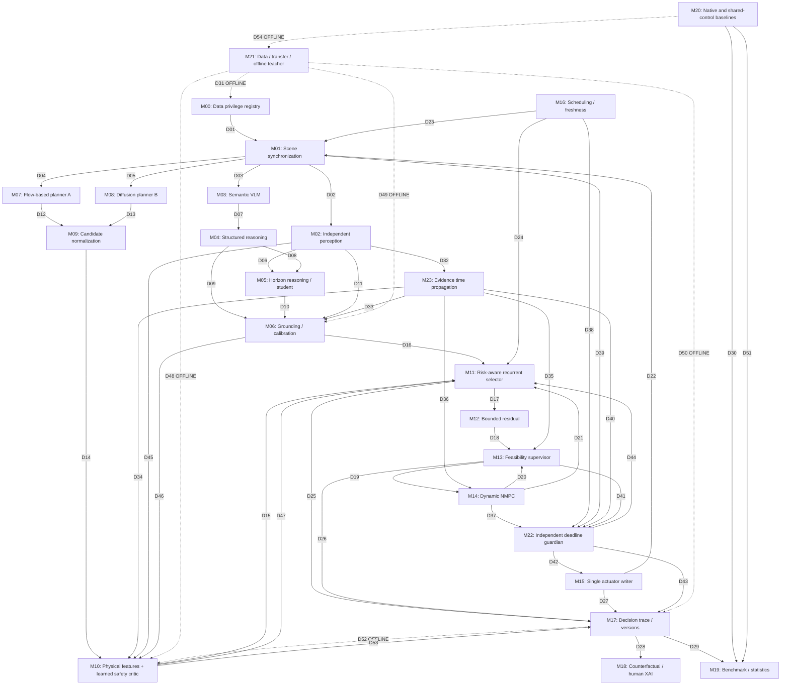

# Complete dependency records — v1.3.1

All 24 modules and 54 payload records (52 unique directed module pairs). Dashed edges are offline-only. This logical data dependency graph is not a process/thread scheduling graph. Current ego, route and immutable candidate references are resolved by the shared snapshot contract.

The compact [main figure](../assets/diagrams/v1_3_1/main_architecture.svg) shows selected online paths for readability. This full view and the table below preserve every registered record.

| Record | From | To | Scope | Payload |
|---|---|---|---|---|
| D01 | M00 | M01 | ONLINE_OR_EVAL | allowlisted source manifest |
| D02 | M01 | M02 | ONLINE_OR_EVAL | scene and calibration |
| D03 | M01 | M03 | ONLINE_OR_EVAL | causal sensor history |
| D04 | M01 | M07 | ONLINE_OR_EVAL | native A input |
| D05 | M01 | M08 | ONLINE_OR_EVAL | native B input |
| D06 | M02 | M05 | ONLINE_OR_EVAL | pooled evidence features for student |
| D07 | M03 | M04 | ONLINE_OR_EVAL | structured semantic proposal |
| D08 | M04 | M05 | ONLINE_OR_EVAL | horizon labels / teacher representation |
| D09 | M04 | M06 | ONLINE_OR_EVAL | actor-linked claims |
| D10 | M05 | M06 | ONLINE_OR_EVAL | horizon claims and confidence |
| D11 | M02 | M06 | ONLINE_OR_EVAL | independent observations / forecasts |
| D12 | M07 | M09 | ONLINE_OR_EVAL | native A candidates |
| D13 | M08 | M09 | ONLINE_OR_EVAL | native B candidates |
| D14 | M09 | M10 | ONLINE_OR_EVAL | canonical candidate set |
| D15 | M10 | M11 | ONLINE_OR_EVAL | features and masks |
| D16 | M06 | M11 | ONLINE_OR_EVAL | grounded semantics |
| D17 | M11 | M12 | ONLINE_OR_EVAL | selected candidate and policy context |
| D18 | M12 | M13 | ONLINE_OR_EVAL | bounded proposal |
| D19 | M13 | M14 | ONLINE_OR_EVAL | accepted reference |
| D20 | M14 | M13 | ONLINE_OR_EVAL | solver failure / veto |
| D21 | M14 | M11 | ONLINE_OR_EVAL | previous tracking/slack/solver feedback |
| D22 | M15 | M01 | ONLINE_OR_EVAL | next environment observation |
| D23 | M16 | M01 | ONLINE_OR_EVAL | request timing and freshness |
| D24 | M16 | M11 | ONLINE_OR_EVAL | decision age / deadline |
| D25 | M11 | M17 | ONLINE_OR_EVAL | sampled action / logp |
| D26 | M13 | M17 | ONLINE_OR_EVAL | override / accepted reference |
| D27 | M15 | M17 | ONLINE_OR_EVAL | executed actuation |
| D28 | M17 | M18 | ONLINE_OR_EVAL | paired state / intervention trace |
| D29 | M17 | M19 | ONLINE_OR_EVAL | metrics and provenance |
| D30 | M20 | M19 | ONLINE_OR_EVAL | baseline comparable results |
| D31 | M21 | M00 | OFFLINE_ONLY | data and platform manifests |
| D32 | M02 | M23 | ONLINE_OR_EVAL | native tracks forecasts and original capture time |
| D33 | M23 | M06 | ONLINE_OR_EVAL | time-aligned evidence with observation lineage |
| D34 | M23 | M10 | ONLINE_OR_EVAL | aged evidence / uncertainty |
| D35 | M23 | M13 | ONLINE_OR_EVAL | current validity envelope |
| D36 | M23 | M14 | ONLINE_OR_EVAL | time-aligned forecast constraints |
| D37 | M14 | M22 | ONLINE_OR_EVAL | solver result with generation and deadline |
| D38 | M16 | M22 | ONLINE_OR_EVAL | clock profile and worker health |
| D39 | M01 | M22 | ONLINE_OR_EVAL | fresh ego and scene snapshot |
| D40 | M23 | M22 | ONLINE_OR_EVAL | evidence age and validity |
| D41 | M13 | M22 | ONLINE_OR_EVAL | reference validation |
| D42 | M22 | M15 | ONLINE_OR_EVAL | sole authorized normal or fallback command |
| D43 | M22 | M17 | ONLINE_OR_EVAL | deadline decision and late rejection |
| D44 | M22 | M11 | ONLINE_OR_EVAL | previous degraded mode / override |
| D45 | M02 | M10 | ONLINE_OR_EVAL | sensor visibility, actor forecast and uncertainty |
| D46 | M06 | M10 | ONLINE_OR_EVAL | grounded claims with occlusion and age |
| D47 | M10 | M11 | ONLINE_OR_EVAL | calibrated SafetyScoreBundle plus candidate features |
| D48 | M21 | M10 | OFFLINE_ONLY | OFFLINE ONLY teacher labels to critic trainer; frozen trained artifact deployed separately |
| D49 | M21 | M06 | OFFLINE_ONLY | OFFLINE ONLY visibility annotation and calibration |
| D50 | M21 | M17 | OFFLINE_ONLY | offline expert and teacher provenance/fingerprint |
| D51 | M20 | M19 | ONLINE_OR_EVAL | new native strong planner and privileged/same-sensor expert baselines |
| D52 | M17 | M10 | OFFLINE_ONLY | offline critic label and calibration cache metadata |
| D53 | M10 | M17 | ONLINE_OR_EVAL | critic per-head scores, calibration and validity |
| D54 | M20 | M21 | OFFLINE_ONLY | OFFLINE ONLY expert scenario recordings |
